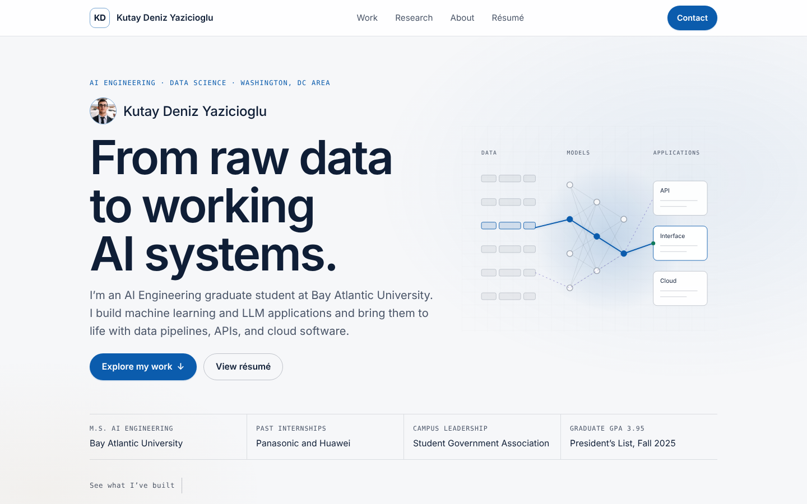
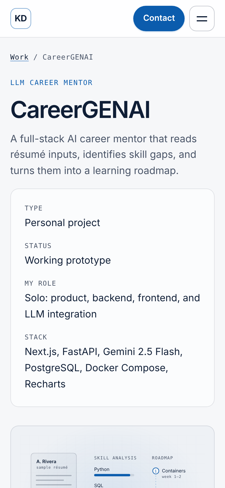

# Kutay Deniz Yazicioglu · Portfolio

Personal portfolio of an AI Engineering graduate student in the Washington, DC area: case studies in LLM applications, optimization, and human–robot interaction, graduate research on prompt injection, and a printable web résumé.

**Live site:** _add your URL after deploying_ · [LinkedIn](https://www.linkedin.com/in/kutay-deniz-yazicioglu/) · [Medium](https://medium.com/@DenizYazicioglu1)



<p align="center"></p>

**Stack:** Next.js (App Router) · TypeScript · React · plain CSS design tokens · AWS Amplify Hosting · Route 53 · Amazon SES (contact email) · DynamoDB (rate limiting)

**Highlights**
- Content lives in typed modules (`content/en`), so projects, roles and links change without touching layout code; ready for a Turkish locale.
- Code-drawn SVG project illustrations, each labeled as illustrative or synthetic.
- Contact API with server validation, a honeypot, a body-size limit, distributed rate limiting, and plain-text email; covered by tests.
- Accessibility: skip link, landmarks, keyboard-safe mobile menu, labeled form errors, reduced-motion support, WCAG AA contrast.
- Printable web résumé with dedicated print styles.

## Run locally

```bash
npm install
cp .env.example .env.local      # CONTACT_DEV_MOCK=true lets the form work without email
npm run dev                     # http://localhost:3000
npm run check                   # lint + typecheck + tests + production build
```

Node 20.9+ is required.

## Directory map

```
app/                    Routes (thin: metadata + a view)
  page.tsx              /            Home
  work/page.tsx         /work        Featured case studies, more projects, experiments
  work/[slug]/page.tsx  /work/:slug  Case studies (static params from content)
  research/page.tsx     /research
  about/page.tsx        /about
  resume/page.tsx       /resume      Printable web résumé
  contact/page.tsx      /contact     ?topic=research preselects the topic
  api/contact/route.ts  POST /api/contact
  not-found.tsx, sitemap.ts, robots.ts, icon.svg, opengraph-image.tsx
  globals.css           Design tokens + all styles (incl. print styles for /resume)
views/                  Page bodies (pure components, shared with the static preview)
components/             Header (mobile menu), ContactForm, ProjectCard, Pipeline, visuals/*
content/
  types.ts              Content model
  en/                   ALL visitor-facing copy: site.ts, projects.ts, resume.ts, research.ts
  index.ts              getContent(locale) — add `tr` here later
lib/                    contact validation, handler, rate limit, email, SEO helpers
tests/                  Contact API tests (node:test via tsx)
scripts/preview/        Builds a single-file static preview from the same components
```

## Updating content (no layout edits needed)

| To change…                          | Edit                                        |
| ----------------------------------- | ------------------------------------------- |
| Name, headline, proof strip, links  | `content/en/site.ts` (`profile`)            |
| Show GitHub / email / Medium        | Fill `profile.links.*` — empty values hide  |
| Add a public résumé PDF             | Put it in `public/`, set `links.resumePdf`  |
| Headshot / photo gallery            | `public/images/`, then `profile.headshot` and `photos` in `content/en/site.ts` |
| Update the résumé PDF               | Replace `public/kutay-deniz-yazicioglu-resume.pdf` |
| Add a case study                    | Append to `projects` in `content/en/projects.ts` (choose an existing `visual` or add one in `components/visuals/ProjectVisual.tsx`) |
| Add code/demo links to a project    | `links: [{ label: "View code", href: "…" }]` |
| Jobs, leadership, volunteering      | `roles` in `content/en/resume.ts` (`group` decides where it appears) |
| Credentials                         | `credentials` (add `url` for a public verification link) |
| Availability flag                   | `profile.availability` (empty hides it)     |

**Adding Turkish later:** copy `content/en` to `content/tr`, translate, register it in `content/index.ts`, then add a `app/[locale]/` segment (or `/tr` routes) that calls `getContent("tr")`. Slugs are ASCII and shared across locales.

## Contact form

- Fields: name, email, message. Server validation (lengths, email format), 8 KB body limit, JSON-only, honeypot field.
- Rate limit: DynamoDB fixed window keyed by a hashed IP (TTL cleans up). Upstash Redis also supported. Without either, production returns 503 rather than run an unreliable per-instance limit; development uses an in-memory limit.
- Email: Amazon SES v2, plain text only, fixed recipient, `ReplyTo` = the validated visitor email. Credentials come from the Amplify compute role, so no AWS keys live in the app. Message bodies and secrets are never logged.
- No message storage. Success means SES accepted the message (the UI says “received”, not “delivered”).
- If configuration is missing in production the form renders disabled with a notice. `CONTACT_DEV_MOCK=true` (dev only) accepts messages without sending.

## Deploy (AWS)

Step-by-step guide: **[docs/DEPLOY-AWS.md](docs/DEPLOY-AWS.md)** (Amplify Hosting, Route 53, SES, DynamoDB, IAM compute role). Build settings live in `amplify.yml`.

Indexing stays off until `NEXT_PUBLIC_SITE_INDEXABLE=true`: robots.txt, meta robots, and an `X-Robots-Tag` header all block it.

**Before launch:** work through `REVIEW.md`.

## Static preview

`npm run preview:static` (or `node scripts/preview/build.mjs`) renders every page with the real components into `preview-dist/index.html`, using hash routes (`#work-careergenai`) and a simulated contact form. It exists for design review only; it is not the deployment.

## Design decisions

- **Light, formal palette**: paper canvas `#F6F7F9`, white cards, navy text `#0F1E36`, one blue accent `#0B5CAD`, violet `#5A4AB5` for research, green `#0F7A5C` for success. All tokens are at the top of `app/globals.css`; every text/background pair passes WCAG AA.
- **CSS tokens instead of Tailwind**: fewer dependencies, one readable stylesheet, print styles colocated.
- **Fonts** via `next/font` (Space Grotesk / Inter / JetBrains Mono), self-hosted at build time, `latin-ext` for Turkish characters.
- **Project visuals are code-drawn SVG** and labeled *illustrative* or *synthetic*; nothing is presented as a result.
- **No client JS** except the mobile menu, contact form, and print button.
- **Motion**: one hero trace (draws once), card lift on hover/focus, and a three-loop scroll cue; all disabled under `prefers-reduced-motion`.
